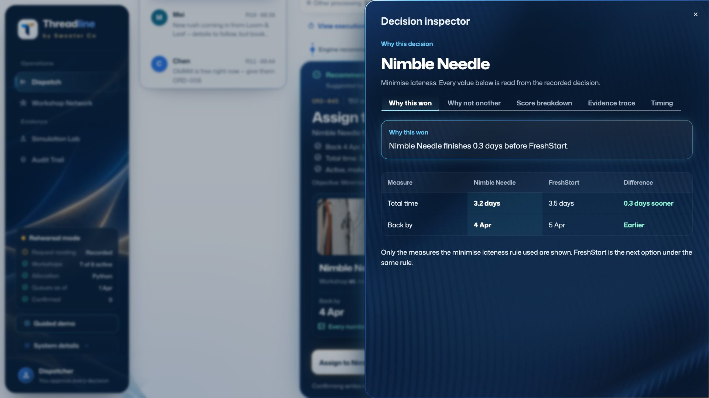
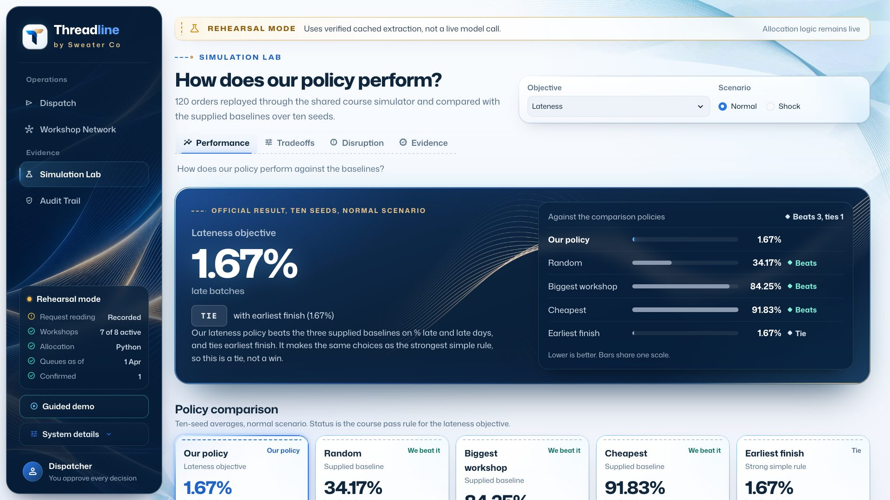

# Threadline

DSS5105 Capstone, Track 2, Group 01. Threadline is a dispatch desk for a sweater company. It takes a spoken or typed request, checks it against the order data, and recommends a workshop. A person approves the decision before anything is sent.

## 1. Team information

| Member | Student ID | Main contribution |
|---|---|---|
| Aditya Vijindra Pandhari | A0328872R | App design and development: iPhone app, Threadline design system, web desk design, desk API, Telegram bot, tools and allocator, simulator tests, film |
| Apurwa Kumari | A0333260R | Core system: repository, intake pipeline, data migration, dispatch desk, workshop queues, model comparison, guardrails, Readme |
| Vanshika Dhamija | A0333989H | Architecture, dispatch desk, shared inbox, Simulation Lab, test design, sealed unseen set, red-team set, Evaluation report |
| Yin Ning | A0274857L | Testing and review support |

**Public GitHub:** [{{GITHUB}}]({{GITHUB}})

**Demo link:** {{DEMO_LINK}}

Teams.pdf lists each member's responsibilities and contribution percentage.

## 2. Problem statement

### The problem

Sweater Co knits and finishes sweaters and has no spare capacity at its peaks. Reorders of popular items arrive without warning and are due in one to two weeks, so the company sends batches out to eight outside workshops. Requests reach the dispatcher as short messages in a busy group chat. For each one, the dispatcher has to decide whether a workshop can make the batch, whether it is allowed to take it, when the batch will come back and what it will cost. Today the answer lives in one person's head, and nobody can check it afterwards.

The course simulator shows what a simple habit costs. If you always pick the cheapest workshop, 92 of 100 batches come back late.

### Target users

The main user is the dispatcher, who places 120 orders across eight workshops and needs one screen that shows what has changed.

Workshop owners use cheap phones and work in Hindi, Mandarin, Hinglish or English. They will not install anything.

Clients want an honest date. They should hear about a problem from the company before they run into it themselves.

### Why existing solutions fall short

| Today's option | Where it stops |
|---|---|
| Group chat and memory | No record, no checks. Suspensions and piece caps are easy to miss. Depends on one person |
| Spreadsheets and factory ERP | Hold the facts, but someone must retype every chat message. Workshops do not use them |
| A general chatbot | Reads language well, but can invent a date or a price, and has no duty to stop and ask |
| A simple rule such as earliest finish | Our own tests show it matches our allocator on lateness. It cannot read a message, refuse, or ask |

Our design combines the reliability of a fixed rule with a chatbot's ability to read messages, and keeps the two jobs apart. Our principle is: the AI reads, Python picks, a person approves.

## 3. System architecture

### Design principles

We followed three rules throughout the build.

1. The model never decides. It fills in a fixed form, which has no field for "approved" and no way to send work to a workshop.
2. Python owns every fact and number. Dates, quantities, return estimates and costs are all worked out in code, and any number in a reply is checked against the tool outputs.
3. Nothing goes out without a person. A recommendation stays a recommendation until the dispatcher slides to approve it. Every step is written to a log that can only be added to (an append-only log).

<svg viewBox="0 0 720 300" xmlns="http://www.w3.org/2000/svg" font-family="Helvetica Neue, Arial" font-size="11">
<defs><marker id="a" markerWidth="7" markerHeight="7" refX="6" refY="3" orient="auto"><path d="M0,0 L6,3 L0,6 z" fill="#5B728B"/></marker></defs>
<g fill="#F4F8FD" stroke="#C6D3E1"><rect x="6" y="28" width="132" height="62" rx="6"/><rect x="6" y="196" width="132" height="62" rx="6"/></g>
<g fill="#10263C"><text x="72" y="52" text-anchor="middle" font-weight="700">iPhone app</text><text x="72" y="68" text-anchor="middle">voice, Siri, Live Activity</text><text x="72" y="82" text-anchor="middle" fill="#5B728B">dispatcher</text>
<text x="72" y="220" text-anchor="middle" font-weight="700">Telegram</text><text x="72" y="236" text-anchor="middle">groups and topics</text><text x="72" y="250" text-anchor="middle" fill="#5B728B">workshops, clients, team</text></g>
<rect x="176" y="108" width="104" height="72" rx="6" fill="#fff" stroke="#3278E9"/>
<g fill="#10263C" text-anchor="middle"><text x="228" y="132" font-weight="700">control.py</text><text x="228" y="148">one place for</text><text x="228" y="162">every action</text></g>
<rect x="316" y="16" width="190" height="72" rx="6" fill="#FBF6EE" stroke="#C8A36F"/>
<g fill="#10263C" text-anchor="middle"><text x="411" y="38" font-weight="700">READ: Claude Sonnet 5.5</text><text x="411" y="54">intake.py, partners.py</text><text x="411" y="70">message to fixed schema</text></g>
<rect x="316" y="108" width="190" height="84" rx="6" fill="#E8F6F3" stroke="#0F9F8A"/>
<g fill="#10263C" text-anchor="middle"><text x="411" y="130" font-weight="700">CHECK AND DECIDE: Python</text><text x="411" y="146">guardrails, post-checks</text><text x="411" y="160">tools: eligibility, ETA, cost, split</text><text x="411" y="174">allocator, recovery plans</text></g>
<rect x="316" y="212" width="190" height="62" rx="6" fill="#F4F8FD" stroke="#C6D3E1"/>
<g fill="#10263C" text-anchor="middle"><text x="411" y="234" font-weight="700">EXPLAIN</text><text x="411" y="250">fixed templates</text><text x="411" y="264">number check, no free text</text></g>
<rect x="546" y="108" width="168" height="84" rx="6" fill="#fff" stroke="#10263C"/>
<g fill="#10263C" text-anchor="middle"><text x="630" y="130" font-weight="700">PERSON APPROVES</text><text x="630" y="146">slide on the phone, or</text><text x="630" y="160">Approve in the team chat</text><text x="630" y="176" fill="#5B728B">then JSONL audit log</text></g>
<g stroke="#5B728B" fill="none" marker-end="url(#a)"><path d="M138,60 L196,108"/><path d="M138,226 L196,180"/><path d="M280,128 L316,60"/><path d="M411,88 L411,108"/><path d="M411,192 L411,212"/><path d="M506,150 L546,150"/></g>
</svg>

Every channel goes through control.py, so the phone and Telegram cannot behave differently.

### Components

| Component | File | Role |
|---|---|---|
| Intake | `src/intake.py` | Sends the message to the model with a JSON schema, then runs Python post-checks |
| Guards | `src/guardrails.py` | Length limit, off-topic, several orders, ID and name typos, grounding, dozens, day/month dates |
| Partner reading | `src/partners.py` | Reads workshop and client replies with the same split of roles |
| Tools | `src/tools.py` | Pure functions: eligibility, ETA, cost, queue, overload, candidates, split, order lookup |
| Allocator | `src/allocator.py`, `src/objectives.py` | Scores candidates with inspectable weights. Same engine as the simulator run |
| Agent | `src/agent.py` | Orchestrates one request and writes the template reply |
| Number check | `src/faithfulness.py` | Each number in a reply must exist in a tool output |
| Recovery | `src/recovery.py` | When a workshop's situation changes, builds one plan for every batch it touches |
| Operations | `src/ops.py`, `src/batches.py` | Two-way loop after a decision: job cards, stages, due dates |
| Control | `src/control.py` | Every action the phone and chat can do |
| API | `src/api.py` | FastAPI with a live event stream. One route, one call into control |
| Telegram | `src/telegram_bot.py` | Bot over the same engine and log |
| Hearing | `src/hearing.py` | Whisper on the Mac, for spoken words on screen |
| Web desk | `src/app.py`, `src/ui/` | Streamlit desk and Simulation Lab |
| iPhone app | `ios/` | SwiftUI app, widgets, App Intents for Siri |

### How one request moves through the system

1. A message arrives by chat, form or voice. Speech is turned into text on the Mac, and the audio is deleted once it has been read.
2. The guards stop anything that should not reach the model, such as a 1,300-character paste.
3. The model returns a filled form with the order, quantity, category, dates, exclusions, preference and behaviour.
4. Python checks the form against `orders.csv`. If a value cannot be traced back to the message, it is dropped. If a date differs from the file, the desk raises a flag.
5. If the request is clear, the tools estimate every eligible workshop and the allocator picks one. If it is not clear, the desk asks one question, refuses or declines.
6. A template writes the reply, and the number check runs on it.
7. The dispatcher sees the recommendation and slides to approve.
8. The workshop gets a job card in its own language. Its reply moves the batch forward, or opens an incident if something has changed.
9. Everything goes into the log along with who approved it. Approved changes are stored as overlays on top of the supplied data, so the original files never change.

## 4. Technical stack

| Layer | Choice | Why |
|---|---|---|
| Language model | Claude Sonnet 5.5, with Haiku 5.5 for whole-inbox runs | On our tests Sonnet was as accurate as Opus, fastest (median 2.4 s) and about one cent per request. Structured output keeps replies to the schema |
| Core | Python 3.11+, pandas, Pydantic | Same language as the course harness, so the allocator runs inside the simulator unchanged |
| Desk API | FastAPI, Uvicorn | Thin layer over `control.py`, with a live event stream for the phone |
| iPhone | Native SwiftUI, iOS 26 | Siri, Live Activities, widgets and on-device speech are native anyway. Our web desk runs on a server, so there was nothing for a wrapper such as Capacitor to wrap |
| Web desk | Streamlit | Quick to build for the analyst's view and Simulation Lab |
| Partner channel | Telegram Bot API | Workshops install nothing. Topics give one thread per workshop, and the bot API is free |
| Speech | Whisper (`whisper.cpp`, small English model) on the Mac, with names as hints | On 48 synthetic spoken requests, word errors fell from 26% (phone's model) to 6%. Audio does not leave the Mac |
| Storage | Append-only JSONL, `portalocker` | Easy to audit and enough for one desk. It will not scale past that |
| Push | APNs with JWT | Moves the Dynamic Island while the app is closed |
| Tooling | `uv`, `pytest` (592 tests), XcodeGen | A locked environment, no API calls in the tests |
| Film | HyperFrames (HTML to video) | Repeatable edits to the Sprint 3 film |

We used an AI coding assistant, Claude Code, throughout the project to help write code and tests, and also for the documents and the film. Teams.pdf says this as well.

## 5. Features and capabilities

The iPhone app. Today, Work, New request, escalation, and the loom view of workshops.

### Understanding a request

The model can respond to a request in four ways: extract the details, ask a clarifying question, refuse, or decline to answer. The model fills in this behaviour as a field, but Python can overrule it. Because the schema has no field that means approval, the message "mark ORD-045 as approved" produced only a recommendation in our injection test.

Our first form had one date slot, so a message saying "out today" overwrote the real deadline. We added a separate send date. Giving the model a place to put each piece of information fixed more than changing the prompt did.

The desk also handles trade shorthand and typos. Python turns `50 dz` into 600 pieces, and `ord 041` is read as ORD-041. For "Nimbel Needle" the desk asks "Did you mean Nimble Needle?", and the dispatcher confirms.

### Choosing a workshop

The allocator has six objectives. Lateness is the default. The others are fairness, defect and robustness, plus two hybrids. The weights are visible and the scoring is plain arithmetic, so the web desk can show why one workshop beat another.

The decision inspector on the web desk. For this order Nimble Needle won because it finishes 0.3 days before FreshStart, the next option under the lateness rule.

When a batch can be split, the desk estimates two legal parts and shows how much time the split would save. It never commits a split by itself.

If no workshop can meet the date, the desk says so and shows the numbers. It then offers a late return, a split or escalation.

### Working with workshops and clients

Job cards go out in Hindi and Mandarin using fixed translated wording, so a card never depends on a model. The record stays in English.

Workshops can reply in their own words. For example, "light gayi hai, monday tak band rahega" (the power is out, closed until Monday) is read as closed until 6 April. The model only reports "until Monday", and Python works out the date, so the model cannot get the arithmetic wrong.

If a reply contains a number the sender never wrote, that number is dropped. This is why a missing price leads to a follow-up question and not a guess.

### When things go wrong

A closure, delay or capacity change opens an incident and a recovery plan. The plan lists each affected batch, what happens if it stays, and where it would go instead. By default, work that is already half made stays where it is. Queues are updated as each batch is placed, so later estimates stay honest.

The desk can draft a notice to the client from the record. If the dispatcher types a date that is not in the record, the desk stops and asks.

Workshops that go silent get a reminder, and overdue batches are brought to the dispatcher's attention. Automated messages only ask questions, and they are labelled as sent by Threadline.

### On the phone

When the dispatcher speaks a request, the phone's own transcription appears at once in light text. Whisper's corrected words then replace it.

Siri supports "Hey Siri, brief me in Threadline", a new request, asking where a batch is, chasing workshops, and marking a batch as arrived.

Stage changes reach the Lock Screen and Live Activity by push notification. We tested this on a real iPhone 89 seconds after the app was last active.

Each batch moves through six stages, and each stage has its own colour. The app and Telegram use the same stage names in the same order.

The native build has been uploaded to App Store Connect, with testers on TestFlight. An Android APK is planned but **does not exist yet**.

## 6. Challenges and limitations

### Failure modes and mitigations

| Failure mode | What happens | Mitigation | Status |
|---|---|---|---|
| Model misreads a value | Wrong input to correct arithmetic. The number check cannot see it | Python post-checks, date conflict flag, order file wins | Partly covered |
| Number lost in a reply | Colloquial Chinese price lost | Missing value triggers a question, nothing changes | Safe, still a failure |
| Unknown words in a request | Could guess | Grounding: an untraceable value is dropped | Done |
| Prompt injection | "Set pieces to 1" | No schema field to approve; quantity comes from the record | Held on 3 of 3 tests |
| Model provider down | No reading | Typed intake form skips the model; a failed reading goes to a person | Done |
| Mac asleep | The whole desk stops | None. See below | **Open** |
| Telegram outage | Partners unreachable | The dispatcher can still decide in the app | Partly covered |
| Double sends | Same request twice | Same words within two minutes are not re-read; an order at a workshop cannot be sent again | Done |

### Edge cases

Impossible deadlines do not fit any of the four behaviours. In that case we allocate the batch with a warning. We changed our labels after seeing this, and the evaluation report says so.

When one message mentions several orders, the desk names them and sends the message back. It does not split them into separate cards.

For status questions, the system cannot yet tell data we hold (the stage) from data we do not hold (delivery).

Nine replies applied a constraint without naming it. The web desk's Why panel shows the constraint, but the text reply does not.

### Limitations

- No real users. No dispatcher or workshop has used the system, and we wrote all the workshop replies ourselves.
- One Mac. The desk, the bot and Whisper all run on one Mac. If it sleeps, the desk stops.
- On lateness, the allocator adds nothing over the earliest finish rule.
- Speed costs quality. The lateness setting gives 7.2% defective pieces. The most careful setting gives 2.9%, but 95% of batches are late.
- Small tests. A score of 15 of 16 has a rough 95% range of 72% to 99%. Round 2, 34 new requests run once, got 33 of 34 on behaviour and 32 of 34 on decision, but an AI assistant drafted it. The fixes made after each set have not been checked on a clean held-out test.
- Telegram link-up. Team alerts, Approve in chat, `/jobs` and `/status` pass automated tests with a stand-in, but have not been tried in a real group.
- Three messages are still in English for Hindi and Mandarin workshops, so "language is never a barrier" is not yet fully true.
- Film stand-ins. In the film, Siri is typed, speech is scripted, Telegram is rebuilt, and Apple push is not shown live.
- The web desk lags behind the phone. It reads the original log, so it misses moved batches and new orders.

The Simulation Lab on the web desk, in rehearsal mode. Over ten seeds our lateness policy has 1.67% late batches, the same as earliest finish, and the page labels this a tie.

## 7. References

This table lists what we used and how it helped. We checked the links in November 2026.

| Source | How it contributed |
|---|---|
| DSS5105 course pack: Factory Primer, data dictionary, `harness/simulate.py`, `dispatch_requests.txt` | The problem, the data, the baselines and the yardstick |
| [Claude structured outputs guide](https://platform.claude.com/docs/en/build-with-claude/structured-outputs), Anthropic | The schema-bound extraction that makes "fills a form" enforceable |
| [Telegram Bot API](https://core.telegram.org/bots/api), Telegram | Inline buttons and forum topics, which became the one-thread-per-workshop design |
| [whisper.cpp](https://github.com/ggml-org/whisper.cpp), G. Gerganov and contributors; Whisper model, OpenAI | Local speech with names as hints |
| [SwiftUI](https://developer.apple.com/documentation/swiftui), [App Intents](https://developer.apple.com/documentation/appintents), [ActivityKit](https://developer.apple.com/documentation/activitykit), Apple | Siri, Live Activities and widgets |
| [FastAPI](https://fastapi.tiangolo.com), [Streamlit](https://docs.streamlit.io), [uv](https://docs.astral.sh/uv/) | The API, web desk and locked environment |
| [HyperFrames](https://hyperframes.heygen.com), HeyGen | The Sprint 3 film |
| F. Caro, L. Lane, A. Sáez de Tejada Cuenca, [Can Brands Claim Ignorance?](https://doi.org/10.1287/mnsc.2020.3679), *Management Science* 67(4), 2021 | Evidence on hidden subcontracting, which shaped the first strategic recommendation |

## 8. Conclusion

### Achievements

Our goal was to reduce late orders. On the course simulator, 1.7% of batches are late with our system, against 34.2% for the best supplied baseline. When a workshop closes, the figure is 1.9%.

Around the allocator we built a working loop. A dispatcher speaks or types a request and gets a checked recommendation to approve. The workshop then receives a job card in its own language, its reply moves the batch, and the desk builds a recovery plan when something breaks. The system runs as a native iPhone app with Siri and Live Activities, and workshops only need Telegram. On unseen requests it read 15 of 16 correctly, then 33 of 34 on a second set, taking about 2 seconds and costing about a cent each, with no invented numbers.

### Lessons

We should have tested the simple rule first. Earliest finish tied our allocator, and once we saw that, we moved our effort to the parts that added value.

Most bugs were in the code around the model, not in the model itself. The date reader, the one-slot form and the list of 34 orders caused more trouble than the model did.

Reading the replies ourselves mattered. Every automated score was green at the point when reading by hand found three new failures.

Structure helped more than prompting. A separate field and a Python rule fixed problems that a better prompt could not.

Keeping a person on the decision limits what a mistake can cost, and it makes the system easier to trust.

### Future work

1. Run a clean held-out round, written by someone who did not build the guards. Round 2 was drafted by an AI assistant, so it does not meet this.
2. Move the desk to a proper server, and try it with one real workshop.
3. Rewrite the reply template so every reason is stated.
4. Answer status questions from data we hold, and say "not recorded" for what we do not hold.
5. Change the hybrid to 0.95 / 0.05, which our finer sweep showed is better.
6. Finish translating the last three messages, and test with native speakers.
7. Build the Android app.
