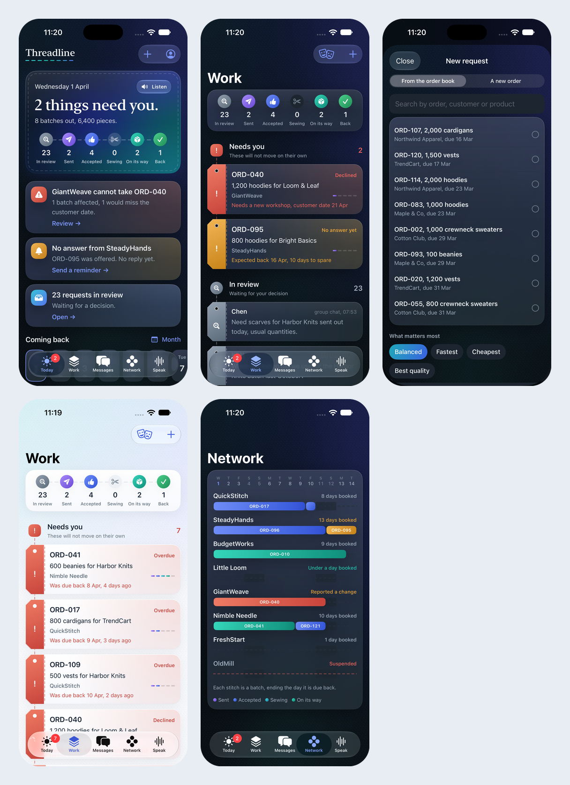

# Threadline

Detailed documentation. DSS5105 Capstone, Track 2, Group 01. A dispatch desk for a sweater company: a spoken or typed request becomes a checked decision that a person approves.

## 1. Team information

| Member | Student ID | Main contribution |
|---|---|---|
| Aditya Vijindra Pandhari | A0328872R | Product, web desk, iPhone app, desk API, film |
| Apurwa Kumari | A0333260R | Dispatch pipeline, intake, tools, data migration |
| Vanshika Dhamija | A0333989H | Evaluation design, labels, held-out set, model comparison |
| Yin Ning | A0274857L | See Teams.pdf |

**Public GitHub:** [{{GITHUB}}]({{GITHUB}})

**Demo link:** {{DEMO_LINK}}

Teams.pdf holds responsibilities and contribution percentages.

## 2. Problem statement

### The problem

Sweater Co knits and finishes sweaters and has no spare capacity at its peaks. Reorders of what is selling arrive without warning and are due in one to two weeks, so batches are sent to eight outside workshops. Requests reach the dispatcher as short messages in a busy group chat. For each one the dispatcher has to answer four things: can this workshop make it, is it allowed to take it, when will it come back, and what will it cost. The answer sits in one person's head, and nobody can check it later.

The course simulator shows how costly a simple habit is. If you always pick the cheapest workshop, 92 of 100 batches come back late.

### Target users

- **The dispatcher,** who places 120 orders across eight workshops and needs one screen to see what changed.
- **Workshop owners,** who run on cheap phones, work in Hindi, Mandarin, Hinglish or English, and will not install anything.
- **Clients,** who want an honest date, and hear from the company before the problem finds them.

### Why existing solutions fall short

| Today's option | Where it stops |
|---|---|
| Group chat and memory | No record, no checks. Suspensions and piece caps are easy to miss. Depends on one person |
| Spreadsheets and factory ERP | Hold the facts, but someone must retype every chat message. Workshops do not use them |
| A general chatbot | Reads language well, but can invent a date or a price, and has no duty to stop and ask |
| A simple rule such as earliest finish | Our own tests show it matches our allocator on lateness. It cannot read a message, refuse, or ask |

So our design takes the rule's reliability and the chatbot's reading, and keeps them apart: **the AI reads, Python picks, a person approves.**

## 3. System architecture

### Design

Three principles shape everything else:

1. **The model never decides.** It fills a fixed form. It has no field for "approved" and no route to a workshop.
2. **Python owns every fact and number.** Dates, quantities, return estimates and costs are worked out in code. Numbers in a reply are checked against tool outputs.
3. **Nothing leaves without a person.** A recommendation is only a recommendation until the dispatcher slides to approve. Every step goes into an append-only log.

<svg viewBox="0 0 720 300" xmlns="http://www.w3.org/2000/svg" font-family="Helvetica Neue, Arial" font-size="11">
<defs><marker id="a" markerWidth="7" markerHeight="7" refX="6" refY="3" orient="auto"><path d="M0,0 L6,3 L0,6 z" fill="#5B728B"/></marker></defs>
<g fill="#F4F8FD" stroke="#C6D3E1"><rect x="6" y="28" width="132" height="62" rx="6"/><rect x="6" y="196" width="132" height="62" rx="6"/></g>
<g fill="#10263C"><text x="72" y="52" text-anchor="middle" font-weight="700">iPhone app</text><text x="72" y="68" text-anchor="middle">voice, Siri, Live Activity</text><text x="72" y="82" text-anchor="middle" fill="#5B728B">dispatcher</text>
<text x="72" y="220" text-anchor="middle" font-weight="700">Telegram</text><text x="72" y="236" text-anchor="middle">groups and topics</text><text x="72" y="250" text-anchor="middle" fill="#5B728B">workshops, clients, team</text></g>
<rect x="176" y="108" width="104" height="72" rx="6" fill="#fff" stroke="#3278E9"/>
<g fill="#10263C" text-anchor="middle"><text x="228" y="132" font-weight="700">control.py</text><text x="228" y="148">one place for</text><text x="228" y="162">every action</text></g>
<rect x="316" y="16" width="190" height="72" rx="6" fill="#FBF6EE" stroke="#C8A36F"/>
<g fill="#10263C" text-anchor="middle"><text x="411" y="38" font-weight="700">READ: Claude Sonnet 5.5</text><text x="411" y="54">intake.py, partners.py</text><text x="411" y="70">message to fixed schema</text></g>
<rect x="316" y="108" width="190" height="84" rx="6" fill="#E8F6F3" stroke="#0F9F8A"/>
<g fill="#10263C" text-anchor="middle"><text x="411" y="130" font-weight="700">CHECK AND DECIDE: Python</text><text x="411" y="146">guardrails, post-checks</text><text x="411" y="160">tools: eligibility, ETA, cost, split</text><text x="411" y="174">allocator, recovery plans</text></g>
<rect x="316" y="212" width="190" height="62" rx="6" fill="#F4F8FD" stroke="#C6D3E1"/>
<g fill="#10263C" text-anchor="middle"><text x="411" y="234" font-weight="700">EXPLAIN</text><text x="411" y="250">fixed templates</text><text x="411" y="264">number check, no free text</text></g>
<rect x="546" y="108" width="168" height="84" rx="6" fill="#fff" stroke="#10263C"/>
<g fill="#10263C" text-anchor="middle"><text x="630" y="130" font-weight="700">PERSON APPROVES</text><text x="630" y="146">slide on the phone, or</text><text x="630" y="160">Approve in the team chat</text><text x="630" y="176" fill="#5B728B">then JSONL audit log</text></g>
<g stroke="#5B728B" fill="none" marker-end="url(#a)"><path d="M138,60 L196,108"/><path d="M138,226 L196,180"/><path d="M280,128 L316,60"/><path d="M411,88 L411,108"/><path d="M411,192 L411,212"/><path d="M506,150 L546,150"/></g>
</svg>

Every channel goes through control.py, so the phone and Telegram cannot behave differently.

### Components

| Component | File | Role |
|---|---|---|
| Intake | `src/intake.py` | Sends the message to the model with a JSON schema, then runs Python post-checks |
| Guards | `src/guardrails.py` | Length limit, off-topic, several orders, ID and name typos, grounding, dozens, day/month dates |
| Partner reading | `src/partners.py` | Reads workshop and client replies with the same split of roles |
| Tools | `src/tools.py` | Pure functions: eligibility, ETA, cost, queue, overload, candidates, split, order lookup |
| Allocator | `src/allocator.py`, `src/objectives.py` | Scores candidates with inspectable weights. Same engine as the simulator run |
| Agent | `src/agent.py` | Orchestrates one request and writes the template reply |
| Number check | `src/faithfulness.py` | Each number in a reply must exist in a tool output |
| Recovery | `src/recovery.py` | When a workshop's situation changes, builds one plan for every batch it touches |
| Operations | `src/ops.py`, `src/batches.py` | Two-way loop after a decision: job cards, stages, due dates |
| Control | `src/control.py` | Every action the phone and chat can do |
| API | `src/api.py` | FastAPI with a live event stream. One route, one call into control |
| Telegram | `src/telegram_bot.py` | Bot over the same engine and log |
| Hearing | `src/hearing.py` | Whisper on the Mac, for spoken words on screen |
| Web desk | `src/app.py`, `src/ui/` | Streamlit desk and Simulation Lab |
| iPhone app | `ios/` | SwiftUI app, widgets, App Intents for Siri |

### Data flow: one request

1. The message arrives by chat, form or voice. Spoken words stay on the Mac and the audio is deleted once read.
2. Guards reject what should not reach the model, such as a 1,300-character paste.
3. The model returns a form: order, quantity, category, dates, exclusions, preference, behaviour.
4. Python checks the form against `orders.csv`. A value that cannot be traced back to the message is dropped. A date that differs from the file raises a flag.
5. If the request is clear, tools estimate every eligible workshop and the allocator picks one. If not, the desk asks one question, refuses, or declines.
6. A template writes the reply, and the number check runs on it.
7. The dispatcher sees the recommendation and slides to approve.
8. The workshop gets a job card in its own language. Its reply moves the batch, or opens an incident if something has changed.
9. Everything is appended to a log with who approved it. Approved changes sit as overlays on the supplied data, so the original files never change.

## 4. Technical stack

| Layer | Choice | Why |
|---|---|---|
| Language model | Claude Sonnet 5.5, with Haiku 5.5 for whole-inbox runs | On our tests Sonnet was as accurate as Opus, fastest (median 2.4 s) and about one cent per request. Structured output keeps replies to the schema |
| Core | Python 3.11+, pandas, Pydantic | Same language as the course harness, so the allocator runs inside the simulator unchanged |
| Desk API | FastAPI, Uvicorn | Thin layer over `control.py`, with a live event stream for the phone |
| iPhone | Native SwiftUI, iOS 26 | Siri, Live Activities, widgets and on-device speech are native anyway. Our web desk runs on a server, so there was nothing for a wrapper such as Capacitor to wrap |
| Web desk | Streamlit | Quick to build for the analyst's view and Simulation Lab |
| Partner channel | Telegram Bot API | Workshops install nothing. Topics give one thread per workshop, and the bot API is free |
| Speech | Whisper (`whisper.cpp`, small English model) on the Mac, with names as hints | On 48 synthetic spoken requests, word errors fell from 26% (phone's model) to 6%. Audio does not leave the Mac |
| Storage | Append-only JSONL, `portalocker` | Easy to audit and enough for one desk. It will not scale past that |
| Push | APNs with JWT | Moves the Dynamic Island while the app is closed |
| Tooling | `uv`, `pytest` (568 tests), XcodeGen | A locked environment, no API calls in the tests |
| Film | HyperFrames (HTML to video) | Repeatable edits to the Sprint 3 film |

An AI coding assistant (Claude Code) was used throughout for code, tests, documents and the film. Teams.pdf says so too.

## 5. Features and capabilities

The iPhone app. Today, Work, New request, escalation, and the loom view of workshops.

### Understanding a request

- **Four behaviours.** Extract, clarify, refuse, decline to answer. *Insight:* behaviour is a field the model fills, but Python can overrule it. The schema has no field that means approval, which is why "mark ORD-045 as approved" produced only a recommendation in our injection test.
- **Separate send date.** Our first template had one date slot, so "out today" overwrote the real deadline. *Insight:* giving the model a place to put each thing fixed more than prompting did.
- **Trade shorthand and typos.** `50 dz` becomes 600 pieces in Python. `ord 041` reads as ORD-041. "Nimbel Needle" gets "Did you mean Nimble Needle?", and the dispatcher confirms it.

### Deciding

- **Six objectives.** Lateness is the default, with fairness, defect, robustness and two hybrids. *Insight:* the weights are visible and the scoring is plain arithmetic, so the panel can show why one workshop beat another.
- **Split preview.** When a split is allowed, the desk estimates two legal parts and shows the time saved. It never commits one by itself.
- **Honest fallback.** If no workshop can make the date, it says so with the numbers and offers late return, split or escalation.

### Working with partners

- **Job cards in Hindi and Mandarin.** Fixed translated wording, so a card never depends on a model, and the record stays in English.
- **Free replies.** "light gayi hai, monday tak band rahega" reads as closed until 6 April. *Insight:* the model says "until Monday", and Python works out the date, so it cannot do the arithmetic wrong.
- **Numbers the sender never wrote are dropped.** That is why a missed price leads to a follow-up question and not a guess.

### When things go wrong

- **Recovery plan.** A closure, delay or capacity change opens an incident. The plan shows each affected batch: what happens if it stays, and where it would go. *Insight:* half-made work stays put by default, and queues move as each batch is placed, so later estimates stay honest.
- **Client notice.** A draft from the record. If the dispatcher types a date that is not in the record, the desk stops and asks.
- **Escalation.** Silent workshops get a reminder, and overdue batches surface. Automations only ask questions and are labelled as sent by Threadline.

### On the phone

- **Voice with live words.** The phone's words appear at once in light ink, and Whisper's corrected words replace them.
- **Siri.** "Hey Siri, brief me in Threadline", new request, where's a batch, chase workshops, a batch arrived.
- **Live Activity and Lock Screen.** Stage changes reach the locked phone by push. Tested on a real iPhone at 89 seconds after the app was last active.
- **Six stages, one colour each.** The same names and order in the app and in Telegram.
- **Distribution.** Native build uploaded to App Store Connect, with testers on TestFlight. An Android APK is planned and **does not exist yet**.

## 6. Challenges and limitations

### Failure modes and mitigations

| Failure mode | What happens | Mitigation | Status |
|---|---|---|---|
| Model misreads a value | Wrong input to correct arithmetic. The number check cannot see it | Python post-checks, date conflict flag, order file wins | Partly covered |
| Number lost in a reply | Colloquial Chinese price lost | Missing value triggers a question, nothing changes | Safe, still a failure |
| Unknown words in a request | Could guess | Grounding: an untraceable value is dropped | Done |
| Prompt injection | "Set pieces to 1" | No schema field to approve; quantity comes from the record | Held on 3 of 3 tests |
| Model provider down | No reading | Typed intake form skips the model; a failed reading goes to a person | Done |
| Mac asleep | The whole desk stops | None. See below | **Open** |
| Telegram outage | Partners unreachable | The dispatcher can still decide in the app | Partly covered |
| Double sends | Same request twice | Same words within two minutes are not re-read; an order at a workshop cannot be sent again | Done |

### Edge cases

- **Impossible deadlines** fit none of the four behaviours. We allocate with a warning. Our labels were changed after seeing this, as the evaluation report states.
- **Several orders in one message** are named and sent back. They are not split into separate cards.
- **Status questions.** The system cannot yet tell data we hold (stage) from data we do not (delivery).
- **Reasons.** Nine replies applied a constraint without naming it. The web desk's Why panel shows it, but the text reply does not.

### Limitations

- **No real users.** No dispatcher or workshop has used it. All workshop replies were written by us.
- **One Mac.** The desk, the bot and Whisper run on one Mac. If it sleeps, the desk sleeps.
- **The allocator adds nothing over earliest finish** on lateness.
- **Speed has a price.** The lateness setting gives 7.2% defective pieces. The most careful setting gives 2.9%, with 95% of batches late.
- **Small tests.** 15 of 16 has a rough 95% range of 72% to 99%. The fixes have no clean held-out test.
- **Telegram link-up.** Team alerts, Approve in chat, `/jobs` and `/status` pass automated tests with a stand-in, and have not been tried in a real group.
- **Three messages stay in English** for Hindi and Mandarin workshops, so "language is never a barrier" is not yet fully true.
- **Film stand-ins.** Siri is typed, speech is scripted, Telegram is rebuilt, and Apple push is not shown live.
- **The web desk lags the phone.** It reads the original log, so it misses moved batches and new orders.

## 7. References

We list what we used and how. Links were checked in November 2026.

| Source | How it contributed |
|---|---|
| DSS5105 course pack: Factory Primer, data dictionary, `harness/simulate.py`, `dispatch_requests.txt` | The problem, the data, the baselines and the yardstick |
| [Claude structured outputs guide](https://platform.claude.com/docs/en/build-with-claude/structured-outputs), Anthropic | The schema-bound extraction that makes "fills a form" enforceable |
| [Telegram Bot API](https://core.telegram.org/bots/api), Telegram | Inline buttons and forum topics, which became the one-thread-per-workshop design |
| [whisper.cpp](https://github.com/ggml-org/whisper.cpp), G. Gerganov and contributors; Whisper model, OpenAI | Local speech with names as hints |
| [SwiftUI](https://developer.apple.com/documentation/swiftui), [App Intents](https://developer.apple.com/documentation/appintents), [ActivityKit](https://developer.apple.com/documentation/activitykit), Apple | Siri, Live Activities and widgets |
| [FastAPI](https://fastapi.tiangolo.com), [Streamlit](https://docs.streamlit.io), [uv](https://docs.astral.sh/uv/) | The API, web desk and locked environment |
| [HyperFrames](https://hyperframes.heygen.com), HeyGen | The Sprint 3 film |
| F. Caro, L. Lane, A. Sáez de Tejada Cuenca, [Can Brands Claim Ignorance?](https://doi.org/10.1287/mnsc.2020.3679), *Management Science* 67(4), 2021 | Evidence on hidden subcontracting, which shaped the first strategic recommendation |

## 8. Conclusion

### Achievements

We set out to reduce late orders. On the course simulator our system has 1.7% of batches late, against 34.2% for the best supplied baseline, and 1.9% when a workshop closes. Around that sits a working loop: a spoken or typed request, a checked recommendation, a person's approval, a job card in the workshop's language, a reply that moves the batch, and a recovery plan when something breaks. It runs as a native iPhone app with Siri and Live Activities, and workshops need nothing more than Telegram. Reading unseen requests, it got 15 of 16 right, about 2 seconds and a cent each, with no invented numbers.

### Lessons

- **Test the simple rule first.** Earliest finish tied our allocator. That moved our effort to where the value was.
- **The bugs were in the code around the model.** The date reader, the one-slot form and the list of 34 orders caused more trouble than the model did.
- **Read the replies yourself.** Every automated score was green when reading by hand found three new failures.
- **Structure beats prompting.** A separate field and a Python rule fixed what a clever prompt could not.
- **Keep a person on the decision.** It limits what a mistake can cost, and it makes the system easier to trust.

### Future work

1. A clean second held-out round, written by someone who did not build the guards.
2. Move the desk to a proper server, and try it with one real workshop.
3. Rewrite the reply template so every reason is stated.
4. Status answers from data we hold, and honest "not recorded" for what we do not.
5. Change the hybrid to 0.95 / 0.05, which our finer sweep showed is better.
6. Finish translating the last three messages, and test with native speakers.
7. Build the Android app.
