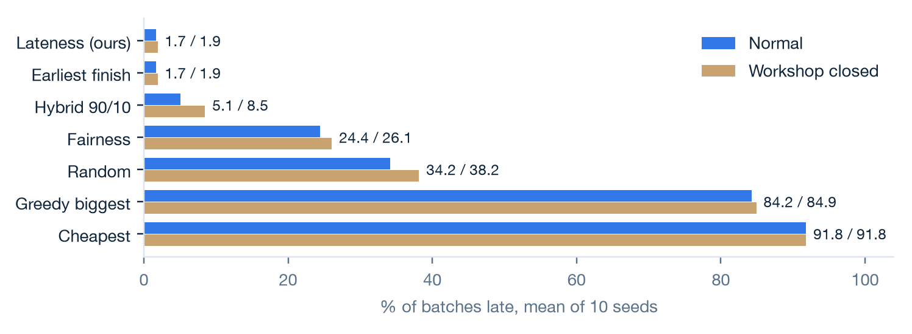
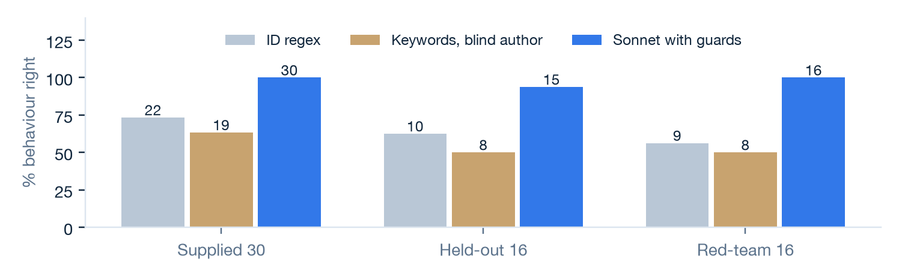

# Evaluation report

Threadline, Group 01, Track 2. How do we know it works, and where does it not?

<b>1.7%</b>of batches late on the simulator, against 34.2% for the best supplied baseline

<b>Tie</b>with the simple rule earliest finish, on every metric. The allocator adds nothing there

<b>33 of 34</b>new requests right on behaviour in Round 2, run once, and 32 of 34 on decision

<b>9 of 9</b>replies that applied a constraint did not say so in the reply text

**Short version.** Our allocation rule is good, but a five-line rule is just as good, so the value is not there. The value is in reading: on requests its authors had not seen, our LLM reader got 15 of 16 right and blind keyword rules got 8. In Round 2, 34 more requests run once on Sonnet, it got 33 of 34 right on behaviour and 32 of 34 on decision. Neither result is fully clean: the fixes to the first set were made after looking at it, Round 2 was drafted by an AI assistant, and no real dispatcher or workshop has used the system. Section 2 says what is and is not a clean result.

## 1. What we measured and why

| Question | Measure | Why this measure |
|---|---|---|
| Are allocations good? | Course simulator: % batches late, late days, busiest workshop's share of pieces, % defective pieces, cost | Same yardstick for every team. Lateness is our primary objective because a late batch loses the margin |
| Does it handle a chat request? | Behaviour (extract, clarify, refuse, decline to answer) against human labels | The wrong behaviour is the costly error: a guess where a question was needed |
| Is the decision right? | Same workshop as an independent earliest-finish reference under the labelled constraints | Judged apart from behaviour, as the brief asks |
| Is the explanation faithful? | Two checks: every number traces to a tool output, and a new review of what the reply says | A right decision with a made-up reason is still a failure. The number check alone cannot see a misleading sentence |
| What does the LLM add? | The same requests through three no-LLM readers | Otherwise "the LLM helps" is only an assumption |
| Is it usable at a desk? | Seconds and estimated cost per request | A dispatcher answers within the hour, often within minutes |

We call the first behaviour *allocate* in the code. It is the brief's *extract*: the facts are read and a recommendation is produced. Nothing is sent until a person approves.

## 2. How the evaluation sets were built, and why they are not rigged

**Simulator.** The unchanged course harness (`harness/simulate.py`, identical to the supplied file), 120 orders, 10 paired seeds (5105 to 5114), with and without `--shock`. Each policy sees the same orders and the same closures. Hybrid weights were chosen on different seeds (6105 to 6114) by a rule fixed before running. We re-ran the whole evaluation on the final code on 2 November 2026, and `results.csv` came back byte for byte.

**The 30 supplied requests.** This is our development set, and we tuned on it. Two reviewers (Vanshika Dhamija, Apurwa Kumari) labelled them independently, then reconciled. They agreed on 27 of 30 behaviours before discussion. Labelling happened after the intake was built. Some columns for one reviewer were drafted by an AI assistant and then reviewed. Three labels (R20, R28, R30) were changed after seeing the system's answers. The change is logged in `eval/labeling/reconciliation.md`. These facts all lean in our favour, so treat 30 of 30 as a development score.

**The held-out set.** 16 new requests (R31 to R47, R39 removed before any run). The team wrote 13; an AI assistant drafted 3 (R44 to R46). Labels were drafted by AI from the rubric and data without running the system, then reviewed by the team. Fingerprints of the files were saved before the first run.

<strong>What is clean and what is not.</strong> On this set, the only result that was never used for development is the first held-out run: <strong>Haiku 5.5, 15/16 behaviour, 13/16 decision</strong>. Sonnet and Opus were run on the same set afterwards to choose a model, so Sonnet's first result (15/16, 14/16) is already a selection. Our final figure, Sonnet 15/16 and 15/16, came after two fixes that were decided from those held-out failures, so it is a development result. We planned a second held-out round written by a teammate who had not built the guards. Round 2, below, is a different kind of test from that plan, and the two fixes made after it have no clean test.

**Round 2 held-out set.** 34 new requests (R48 to R81), covering the supplied kinds of request plus some messy chat. An AI assistant drafted them after reading the guard documents and past failures, and the team then rephrased them. Orders began from a seeded draw, then were limited by request type and swapped by hand to avoid near-copies of earlier requests. The AI drafted the labels from the rubric and data without running the system, and a script checked them against the data. The team had not reviewed the labels before the run. Fingerprints were saved first (`eval/heldout_round2/freeze_manifest.txt`), then Sonnet 5.5 ran once on 7 November 2026 at commit `95a0815`. This is not the set we planned, which was to be written and labelled by a teammate who did not build the guards, so we report it as a first run on new requests with those limits.

**Red-team set.** 16 messages we wrote to break the system (gibberish, injection, typos, several orders in one message). We then built the guards against the failures, so 16 of 16 shows they do what they were built to do and nothing more.

**The rule readers.** Written for this report so "what the LLM adds" is measured. The first attempt was contaminated: the author (an AI assistant) had just read all 46 messages, and that reader scored 29 of 30 and 16 of 16. We kept it as an upper bound and asked a separate agent, barred from every request, label and evaluation file, to write rules from the data dictionary alone. Its file was not edited after its first run. Scoring favours all the rule readers, as section 3.4 explains.

## 3. Results

### 3.1 Simulator: objectives against the baselines

{{SIMULATOR}}

Mean of 10 paired seeds. SD is across seeds, for normal runs. Sources: eval/results.csv, eval/results_per_seed.csv.

- **Primary objective.** Lateness beats all three baselines on % late and late days in both scenarios. The closure moves it only from 1.7% to 1.9%, about one extra late batch in 120 in the worst case.
- **Second objective.** Fairness brings the busiest workshop's share down to 17.5%, and % late (24.4) stays within its guardrail of no worse than random.
- **Hybrid.** 90% lateness and 10% fairness gives 5.1% late with the busiest share at 19.7%. It gives up 3.4 points of lateness for most of the fairness gain. Under closure it rises to 8.5%, so spreading work makes the desk more exposed to a closure.
- **Lowest defect.** It fails its guardrail: 2.9% defective pieces, but 95.1% of batches late. We report it and do not offer it as a default.

### 3.2 Where a baseline wins, and what we add over a simple rule

There are 83 strict pairwise cases in the normal run and 80 under closure where a baseline or the simple rule beats one of our presets. All are listed in `eval/baseline_wins.md`. The ones that matter:

- **Earliest finish ties our lateness preset on every metric, in both scenarios.** With its default weights, our allocator reduces to "whoever finishes first". The rule is about the size of a shipped baseline and uses no LLM. For pure allocation, our system adds nothing.
- **Cheapest always costs least**: 85,960 against 115,566, a gap of 26%. It is late 92% of the time.
- **Random and greedy biggest are both cheaper than our lateness preset.** Speed costs about 3 to 7%.
- **Random beats our lateness preset on defects** (5.6% against 7.2% of pieces), because fast workshops are not the careful ones.
- **Earliest finish beats every other preset on lateness**, including the hybrid.

What we add is everything around the rule. A simple allocator takes a clean order and returns a workshop. It cannot read a chat message, refuse a suspended workshop by name, ask when the date is unconfirmed, decline a question the data cannot answer, or leave a record of who approved what. The next section measures the first of these.

### 3.3 The 30 supplied requests, by behaviour (development set)

{{DEV}}

Sonnet 5.5, final code. Model replies recorded earlier and re-scored offline on 2 November 2026; the guards changed one result (R19, failure 5). A second re-score on 7 November 2026, after the Round 2 fixes, left this table unchanged. "Explanation fully clear" is the new review in section 3.5. Every request is listed in the appendix.

The one decision miss is R19, a deliberate change. The first live run of the original system, on Haiku, scored 28/30 on both behaviour and decision.

### 3.4 What the LLM adds: rule readers on the same requests

{{READERS}}

Numbers on bars are requests right. Source: eval/rule_baseline/, run with eval/run_rule_baseline.py. No model call.

Each reader feeds the same reference allocator. Scoring favours the rules: for them a clarify or decline counts as a right decision on behaviour alone, while ours must also pass the candidate-list checks. On the red-team set our decision score is 13 of 16 because the scorer still expects the old 34-order list, which the guards removed on purpose (failure 13).

This is the most useful comparison in the report. On held-out requests, rules from a blind author got 8 of 16 and ours 15 of 16. Rules written with sight of the messages got 16 of 16, which says something uncomfortable: **these 46 messages are short, English and regular enough that a person who has read them can cover them with keywords.** That rule fails on new phrasing: on the red-team set, which it had not read, it falls to 9 of 16. The LLM's lead is the ability to cope with messages nobody planned for. Our evidence for that is 16 unseen requests, the 34 in Round 2 and the partner replies below, so it is promising and not proven. We have not run the rule readers on Round 2.

### 3.5 Explanation review: is what the reply says true, and does it say why?

The number check only proves a number came from a tool. So we added a review of all 46 replies, by script and by reading each one (`eval/run_explanation_review.py`, `eval/explanation_review.csv`). The reading was done by an AI assistant and has not yet had a second human reader.

| Check | Result | Reading |
|---|---:|---|
| Every number traces to a tool output | 46/46 | No invented numbers |
| Days, return date and cost, recomputed from `workshops.csv` | 32/32 | The arithmetic in every reply with a workshop is right |
| An applied exclusion or preference is named in the reply text | **0/9** | True but not explained. See failure 10 |
| ALREADY LATE only on a request for placement | 2/4 | Shown on two information questions. See failure 9 |
| A clarification asks only for what is missing | 0/6 | Asks for a due date the order file holds. See failure 11 |

No reply states something false about an order. Seventeen of the 46 could be clearer, and we count those as explanation weaknesses separately from the decision. The 34 Round 2 replies have not had this review.

### 3.6 Held-out requests, models, red team, partners, speed

{{HELDOUT}}

| Run | Set | Behaviour | Decision | Status |
|---|---|---:|---:|---|
| **Haiku 5.5, original system** | **Held-out 16** | **15/16** | **13/16** | **Clean, run once** |
| Sonnet 5.5, original system | Held-out 16 | 15/16 | 14/16 | Model selection |
| Opus 5.5, original system | Held-out 16 | 15/16 | 14/16 | Model selection |
| Haiku 5.5, after fixes | Held-out 16 | 13/16 | 13/16 | Development. Haiku got worse |
| **Sonnet 5.5, after fixes (final)** | **Held-out 16** | **15/16** | **15/16** | **Development** |
| Opus 5.5, after fixes | Held-out 16 | 15/16 | 15/16 | Development |
| **Sonnet 5.5, at the Round 2 run** | **Round 2, 34** | **33/34** | **32/34** | **Run once, limits in section 2** |
| Sonnet 5.5, after Round 2 fixes | Round 2, 34 | 34/34 | 33/34 | Development, saved replies re-scored |
| Sonnet 5.5, after Round 2 fixes | Held-out 16 and Round 2, 50 | 49/50 | 48/50 | Development, not clean |
| Sonnet 5.5, after Round 2 fixes | Supplied 30 | 30/30 | 29/30 | Development, saved replies re-scored |

15 of 16 corresponds to a rough 95% Wilson range of 72% to 99%. For Round 2, 33 of 34 gives 85% to 99.5% and 32 of 34 gives 81% to 98%. Round 2 by expected behaviour, behaviour then decision: allocate 17/18 and 17/18, clarify 8/8 and 7/8, refuse 4/4 and 4/4, decline 4/4 and 4/4. Numbers traced to tools 34/34, constraint honoured 31/33 scored rows, late flag 24/25 scored rows. Only Sonnet was run on Round 2. We chose Sonnet because accuracy tied or beat the others, it was fastest, and it costs about one cent. It was not chosen on a clean basis.

| Other measure | Result | Note |
|---|---|---|
| Red-team, behaviour | 10/16 before guards, 16/16 after | Development set. Supplied 30: unchanged, one intended decision change. Held-out: 0 rows changed |
| Prompt injection | 2/3 held before guards, 3/3 after | "Mark as approved" produced only a recommendation: the schema has no such field. The third asked for the system prompt |
| Workshop replies, development | 42/48 before fix, 48/48 after | English 12, Hinglish 12, Hindi 12, Chinese 12 |
| Workshop replies, held-out | 11/12 | Hindi 6/6, Chinese 5/6. Written after the fix. Sender languages only, never real workshop staff |
| Speech, word errors | 26% phone model, 6% Whisper with names as hints | 48 spoken requests in 4 synthetic voices. Real speakers will differ |
| Speed | Median 2.4 s, slowest 5.7 s server; 2.52 s median, 5.84 s slowest click to screen | 30 requests, one run. The Python engine takes about 2 ms |
| Cost | About $0.011 per request | Estimated from list prices, not billed |
| Automated tests | 592 passed | Run 7 November 2026. No model calls |

## 4. Failure cases

### Failure 1. R04 and R25: a date with words in front of it

*"ORD-041 needs a home today. 600 beanies, back by Apr 21."* Haiku's first run asked for the due date instead of allocating. The Python date reader could not parse a date with words before it, so it threw away a correct model reading. Wrong behaviour on 2 of 30. **Fixed** in the date reader. This was our own parsing bug, not a model error.

### Failure 2. R44: the model filled the wrong date slot

*"Maple & Co are chasing ORD-083, it's already late. Can we get the hoodies out today?"* All three models read "out today" as the deadline and reported 8 days late, not 17. The template had one date slot, and the model never sees the file's due date, so the message date overrode it. The number check passed, because 8 was a true tool output from a wrong input. **Fixed** with a separate send-date field and a check that flags a conflict with the order file. The fix is not cleanly tested.

### Failure 3. R36: vague quality wording ignored

*"ORD-082, 600 Beinie for TrendCart, due May 1. Ensure quality."* Haiku ignored this and chose a 5% defect workshop over a 2% one. Vague wording was not mapped to a preference. **Fixed** by rule version 2, where quality words mean lowest defect, still subject to the date. We set that rule after seeing this failure, and relabelled to match.

### Failure 4. R34: cannot say what it does not know

*"is ORD-069 delivered to client?"* Expected: decline, because delivery is not recorded. All models instead asked whether the sender wanted a status answer. The rules send every status question to clarify, and cannot separate data we hold (stage) from data we do not (delivery). Harmless, but it is a question that leads nowhere. **Open**, and it is the one miss on the first 16 held-out requests in our final score.

### Failure 5. R19: the reply got better and the score got worse

*"That big reorder from last week, send it to whoever is quickest."* The old reply listed all 34 open orders, which the frozen evaluator expects. The guard now asks for the order ID in one line. We think that is better, and it costs a point. We did not change the evaluator, so we report 29/30.

### Failure 6. R23: split wording read differently

*"Split it across two shops if that gets it back faster."* The workshop and split preview were right. Sonnet did not record "fastest" as a preference, while the label does. "Faster" is a condition on splitting, and readers disagree whether it is a preference. **Open**, minor. It is the one constraint miss left: the score was 28/30 and is 29/30 after the fix in failure 7.

### Failure 7. R25, R41 and R52: who gave the instruction was lost

*"...keep it away from BudgetWorks..."* The exclusion was applied and the workshop was right, but the audit record omitted who imposed it. Seen with Sonnet on R25 and R52 and Haiku on R41. The field is optional for the model. Across the Sonnet runs on the supplied 30, the first 16 and Round 2, it named who gave only 3 of 20 labelled constraints, all of them exclusions. The score hid this, because the evaluator checks who gave the instruction on exclusions only, and it still does. **Fixed in Python, not cleanly tested**: when a constraint is applied and the model names nobody, the record now takes the sender and marks it as assumed. The assumption can be wrong: R15 came from Boss through Mei and now records Mei.

### Failure 8. R42 and R45: Haiku became worse after our fixes

*"ORD-040, assign something, due date to be confirmed."* Haiku allocated using the file date. On R45, *"as long as it arrives on time"* made it ask for a date. Its held-out behaviour fell from 15 to 13, which suggests it had been right on these partly by accident. **Open** for Haiku, which still does background reading of the whole inbox. Sonnet is right on both.

### Failure 9. R13 and R47: ALREADY LATE on a question

*"Finance asks: what price did we quote TrendCart on ORD-120?"* The reply correctly declines, then adds "ALREADY LATE: the requested deadline is today or in the past." Nobody asked for a deadline. The flag runs on the order's file date for any behaviour. On R47 the order is due today, so "late" is also not yet true. All automated checks pass. Found only by reading. Round 2 shows the same on R49, R55 and R69. **Open**, a one-line fix.

### Failure 10. Nine replies apply a constraint and do not say so

R09, R12, R21, R25, R27, R32, R36, R41, R45. R21 asks for the cheapest shop that makes the date. The reply says "Lowest score among permitted candidates", with no word about BudgetWorks being cheaper and three days late. R25 keeps away from BudgetWorks and never mentions it. Each decision is right and each sentence is true, but the template states the winner's numbers, not the reason. The **Why this decision** panel on the web desk does show it. The text reply is what the evaluator scores. **Open.** This is the most important explanation gap, since the promise of the product is that a person can see why.

### Failure 11. Six clarifications ask for a date we already hold

R01, R03, R10, R15, R29, R37. *"Which order do you mean: ORD-061; ORD-108? What is the confirmed due date, including the year?"* Once the order is picked, the date comes from the file. The system asks because the message gave none. It adds a round of chat and looks careless. R10 is also weak: "New rush... details to follow" is a new order, and the reply lists existing ones. Round 2 shows the same extra question on R50, R62 and R74. **Open.**

### Failure 12. C26: a price lost in Chinese

每件涨到2块 ("up to 2 per piece"). The model read a price change and lost the number. Because the number was missing, the desk asked the workshop again and changed nothing. The failure is safe but real: it is the one held-out miss in partner replies, and the film shows it. English "up to 1.8 per piece" works, so colloquial Chinese numbers need more testing. **Open.** It was found before the Sprint 3 film and is one of its stated limits.

### Failure 13. The red-team set before the guards

Before the guards, 6 of 16 behaviours were wrong and 9 of 15 extra checks failed. Gibberish (*"asdf ok?? lol"*), off-topic questions and a request for the system prompt all listed the 34 open orders. *"ord 041"* and *"ORD45"* were declined as unknown. Two orders in one message lost one. The cause was one path: anything without a clean order became a clarify with every open order. **Fixed** in Python guards, on the set they were built against. Several orders are still asked about, not split into cards. Guards have not been run with Haiku.

### Failure 14. R20, R28, R30: a case the four behaviours do not cover

An impossible deadline. Reviewers split between refuse and decline, and the system allocated with a warning. None of the four fits "complete but impossible". We moved the labels to allocate after seeing the system's answer. That helps our score, so we report it: without the change, the first-run score would be three lower. A human should decide this category in advance.

### Failure 15. The hybrid we ship is not the best one we found

The rule picked 0.1 on the 0.1-step grid, and we ship it. On a finer grid, the same rule picks 0.05: 4.0% late, 19.2% busiest share, 5.5% late under closure, against 5.1%, 19.7% and 8.5%. 0.05 is better on all three. **Open.** We kept 0.1 for this report rather than change it after seeing the course seeds. It should change, with new seeds kept apart.

### Failure 16. R63: "due today" was not read

*"ORD-029, 1500 beanies for Northwind, due today. Any shop that can take it?"* The model correctly copied "due today", but the Python date reader accepted only the bare word "today". The system asked for a date it had been given and gave no late warning. This is the one behaviour miss in Round 2. **Fixed** in the date reader, which still does not read "out today" as a deadline. Not cleanly tested. Other wording, such as "by end of today", still gets a question.

### Failure 17. R61: a named workshop was ignored

*"Please assign ORD-036 to SteadyHands. 1000 scarves for UrbanThread, due Apr 26."* SteadyHands can take the order, but the reply recommends Nimble Needle and never mentions SteadyHands. Both return on Apr 11. Every scored check passed, because our label named no expected workshop and the evaluator did not check the named one. We found it by reading the reply. A dispatcher can still override it. **Open**, and not counted in the Round 2 score.

### Failure 18. R50 and R65: the reply was right and the evaluator marked it wrong

*"Northwind's polos need to go out."* The reply named the right two orders, but the evaluator did not recognise "Northwind" or "polos" and expected all 34 open orders. On R65 the system correctly recorded the instruction as Boss's, relayed by Ravi, but the evaluator looks for "boss says" and the message says "Boss said". We did not change the evaluator, so both stay counted as misses: R50 on decision and R65 on constraint.

**Pattern.** Most serious failures came from Python around the model, not the model: the date reader, the one-slot template, the list of 34 orders, the misplaced flag. The checks we built could not see these, because each one tests a narrow thing. Reading replies by hand found failures 9, 10 and 11 after every automated score was green.

## 5. Limits of this evaluation

- **No real users.** No dispatcher or workshop has used it. All the workshop replies were written by us.
- **Small sets.** 16 and then 34 held-out requests, and 12 held-out replies. One run per model, Round 2 on Sonnet only, and Claude's current models accept no temperature setting, so we have no measure of run-to-run variation.
- **Partly AI-drafted.** 3 of the first held-out requests, all 34 Round 2 drafts, the labels for both sets, some reviewer columns, the blind reader and the explanation reading.
- **Gaps in Round 2.** Rephrasing removed the day/month date from R57, so that guard is not tested there. R58 and R66 are judgement calls on the labels, and both passed as labelled.
- **The simulator checks the allocation rule, not the app.** It has no chat, no language and no person in the loop. The demo also differs from this report: orders in the film start from eight earlier decisions, so queues differ and ORD-045 goes to FreshStart, while this evaluation resets queues for each request and gives Nimble Needle.
- **Estimates, not measurements.** Workshop speed and defect rates are the supplied values, and the desk assumes they hold.

## 6. What we would measure with more time

1. **A clean held-out round.** At least 20 new requests, with orders drawn by seeded sampling, written and labelled by a teammate who did not build the guards, frozen, run once. Round 2 did not meet this, and the two fixes made after it have no clean test.
2. **Repeat runs.** Sonnet three times on all sets, to see how much the score moves between runs.
3. **A second human reader** for the explanation review, then a rewrite of the reply template and a re-run.
4. **Usability with at least three people** acting as dispatchers: time per decision, errors, whether they trust the reason. We can measure time saved only this way.
5. **Real Hindi and Mandarin speakers** on written replies and speech, on real phones in noise.
6. **Costs from real invoices** and a week-long run on one Mac, to see how the single point of failure behaves.

## Appendix: all 30 supplied requests

Decision and Numbers are the evaluator's checks. Explanation is the review in section 3.5. Workshops are W1 QuickStitch, W2 SteadyHands, W3 BudgetWorks, W4 Little Loom, W5 GiantWeave, W6 Nimble Needle, W7 OldMill (suspended), W8 FreshStart (300-piece cap). Refuse rows show the alternative offered, with no allocation made.

{{REQUESTS}}

